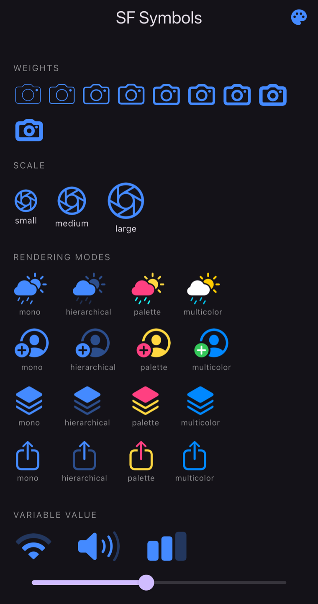
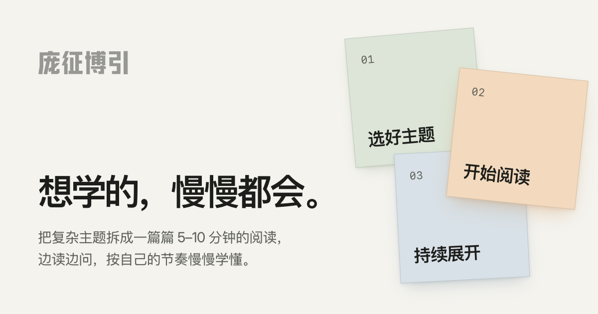
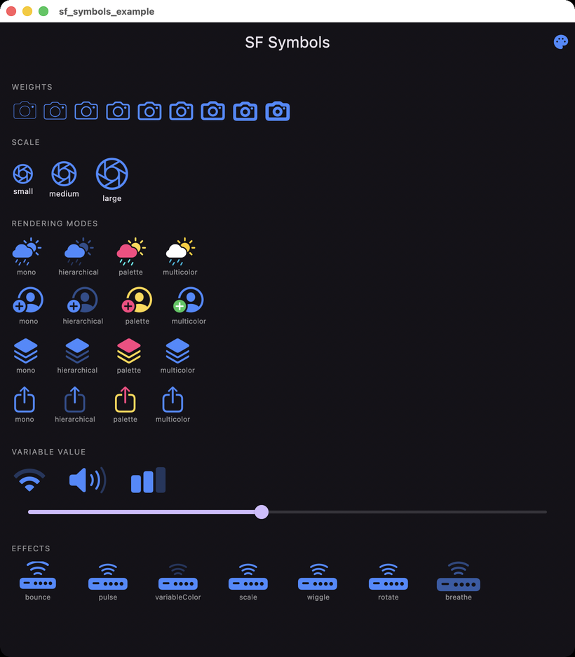

# sf_symbols



Use [SF Symbols](https://developer.apple.com/sf-symbols/) on iOS and macOS, the same way you would
use `Image(systemName:)` or `UIImage(systemName:)` in Swift.

## Sponsor

<a href='https://pangzhengboyin.com/?utm_source=pubdev&utm_medium=sponsorship&utm_campaign=flutter_packages&utm_content=sf_symbols_readme_banner'></a>

This package is sponsored by [庞征博引](https://pangzhengboyin.com/?utm_source=pubdev&utm_medium=sponsorship&utm_campaign=flutter_packages&utm_content=sf_symbols_readme_text), which breaks complex
subjects into 5–10 minute reads you work through, and ask questions about, at your own pace.

## Requirements

| | |
| --- | --- |
| Flutter | 3.27 or newer |
| iOS | 15.0 or newer |
| macOS | 12.0 or newer |
| Build system | Swift Package Manager or CocoaPods |

iOS and macOS only. On other platforms the widget draws nothing instead of failing, so it is safe to
leave in a cross-platform tree — `SfSymbol.isAvailable` answers false there, and
`SfSymbol.effectSupport` answers `none`.

## Usage

Use `SfSymbol` like any other widget, with a name, weight, color and size.

`size` is the `pointSize` of [UIImage.SymbolConfiguration](https://developer.apple.com/documentation/uikit/uiimage/symbolconfiguration/3294242-init),
so a symbol of size 40 renders roughly 40 x 40 logical pixels — the widget sizes itself to whatever
the system actually draws, which is rarely exactly square.
```dart
SfSymbol(
    name: 'camera.aperture',
    weight: FontWeight.w900,
    color: Colors.pink,
    size: 40,
)
```

Names come from the [SF Symbols app](https://developer.apple.com/sf-symbols/). If a name does not
exist on the running OS version, the widget renders nothing rather than throwing. Check first with
`await SfSymbol.isAvailable('camera.macro')` if you want to fall back to something else.

The widget re-renders whenever its properties change, so a symbol can be tinted on press or swapped
out as state changes.

### Rendering modes

SF Symbols draw in four modes. Each has its own constructor:

```dart
// One flat color.
SfSymbol(name: 'cloud.sun.rain.fill', color: Colors.blue, size: 40)

// One color, applied at several opacities across the symbol's layers.
SfSymbol.hierarchical(name: 'cloud.sun.rain.fill', color: Colors.blue, size: 40)

// Up to three colors, assigned to the layers in order.
SfSymbol.palette(
  name: 'cloud.sun.rain.fill',
  colors: [Colors.pink, Colors.amber, Colors.cyan],
  size: 40,
)

// The symbol's own colors. `color` tints symbols that have no multicolor variant.
SfSymbol.multicolor(name: 'cloud.sun.rain.fill', color: Colors.blue, size: 40)
```

### Variable symbols

Symbols such as `wifi`, `speaker.wave.3` and `battery.100` draw a fill level from
`variableValue`, between 0.0 and 1.0. Requires iOS 16 or macOS 13; earlier versions draw the symbol
full.

```dart
SfSymbol(name: 'wifi', color: Colors.blue, size: 40, variableValue: 0.45)
```

### Scale and accessibility

`scale` maps to [`UIImage.SymbolScale`](https://developer.apple.com/documentation/uikit/uiimage/symbolscale),
sizing the symbol relative to its point size. `semanticLabel` describes the symbol to VoiceOver.

```dart
SfSymbol(
  name: 'camera',
  color: Colors.blue,
  size: 40,
  scale: SfSymbolScale.large,
  semanticLabel: 'Camera',
)
```

### Effects

Symbols can play the SF Symbols animations. Pass an `effect`:

```dart
SfSymbol(
  name: 'wifi.router.fill',
  color: Colors.blue,
  size: 40,
  effect: SfSymbolEffect.variableColor,
)
```

`bounce`, `pulse`, `variableColor` and `scale` need iOS 17 or macOS 14; `wiggle`, `rotate` and
`breathe` need iOS 18 or macOS 15. Asking for an effect the running OS cannot play leaves the symbol
still rather than failing, so no version check is required. `await SfSymbol.effectSupport()` reports
what the device can play if you want to choose a different effect or hide a control.

`effectRepeats: false` plays the effect once instead of looping. That only applies to the effects
that have a natural end — `bounce`, and one cycle of `variableColor`. `pulse`, `wiggle`, `rotate`
and `breathe` run for as long as the symbol is on screen, and `scale` holds the symbol at its new
size.

Animated symbols are redrawn every frame, so use them for the few symbols the user is meant to
look at, not for every icon on the screen.

### Caching

Identical symbols share one native texture, so a list of a hundred rows showing the same icon costs
one rendered image rather than a hundred. A symbol that is already rendered draws on its first
frame, with no blank gap while the platform channel answers.

Symbols scrolled off screen are kept for a while in case they come back. To render one before it is
first shown:

```dart
await SfSymbol.precache(
  const SfSymbolConfig(name: 'camera', size: 40, colors: [Colors.blue]),
);
```

The config has to match the one the widget asks for, down to the size and the weight, or the two
are different images. `someSymbol.config` gives you the config of an `SfSymbol` you already have.

`SfSymbolCache.instance` exposes `maximumUnusedEntries` (48 by default) and `evictUnused()` for
apps that want to tune the off-screen pool or drop it under memory pressure. Animated symbols are
never pooled: keeping one alive would keep its display link running.

### macOS



The same widget, the same API. Two differences come from AppKit rather than from this package:

- Symbols are drawn with `NSFont.Weight`, so a `FontWeight` maps to the nearest of the nine AppKit
  weights, exactly as it maps to `UIImage.SymbolWeight` on iOS.
- A multicolor symbol whose variant leaves a layer uncolored is drawn in `color` on both platforms,
  but on macOS that takes an extra pass: AppKit paints those layers black and offers no way to say
  otherwise through a symbol configuration.

## How it works

The system renders the symbol into a pixel buffer, which Flutter draws as a
[`Texture`](https://api.flutter.dev/flutter/widgets/Texture-class.html). The symbols are the real
ones, at whatever version of the SF Symbols set the machine ships, and an animated symbol is a
UIKit or AppKit symbol effect with its frames pushed into the texture.

## Running the example

```sh
cd example
flutter run -d macos                       # or an iOS simulator or device
```

The end-to-end tests exercise the native side, so they need a real device — the Mac counts as one:

```sh
cd example
flutter test integration_test -d macos     # and again with an iOS device id
```

## Roadmap
- Dynamic Type, so symbols follow the system text size
